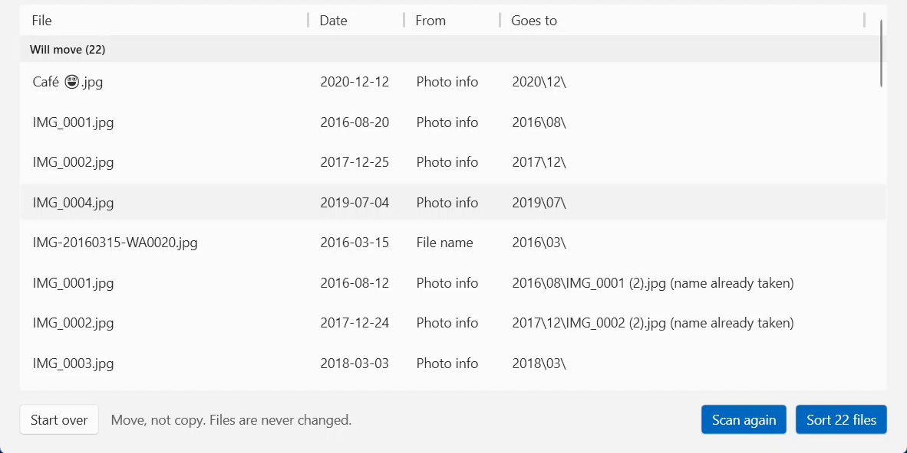

# WhenFiled

WhenFiled moves photos and videos copied from a phone into `Year\Month` folders by the date each was taken.
It shows where each date came from, and can undo the move.

## How to use

1. Download `WhenFiled.App.exe` from the Releases page. Nothing else needs installing. Windows 11, x64.
2. Pick a **source folder** (subfolders are included) and a **destination folder** on the same drive. The destination can't be inside the source.
3. Click **Scan**. This only builds a preview and changes nothing. Each file shows its date, where it came from (EXIF, Video, File name or None) and its target folder.
4. Click **Sort** to move the files to `Destination\YYYY\MM\`. Files it did not move are listed with the reason. Files with no date stay where they are.
5. Not happy? Click **Undo last sort**.

Try it on a copy of some photos first. Files are only moved, never changed, and never overwritten (a clash gets a ` (2)` added to the name).

## What v1 does NOT do

- Moves across drives, or a copy mode
- Undo that survives a crash or closing the app; more than one level of undo
- Paths longer than 260 characters
- Cancel during a sort, or a progress bar
- A speed target
- Day folders, custom templates, renaming, or writing dates into files
- File system dates, Google Takeout JSON, RAW formats, editing dates by hand
- Importing from a phone over USB, OneDrive or Google Photos
- Network drives, Windows 10, macOS, a command line, background running

## Not code-signed

The exe is not code-signed, so Windows SmartScreen may warn "Windows protected your PC". Check the download against `WhenFiled.App.exe.sha256` (`certutil -hashfile WhenFiled.App.exe SHA256`), then choose **More info > Run anyway** if it matches.

## Build

Needs the .NET 10 SDK: `dotnet build WhenFiled.slnx`, `dotnet test WhenFiled.slnx`.

## License

MIT, see [LICENSE](LICENSE).
